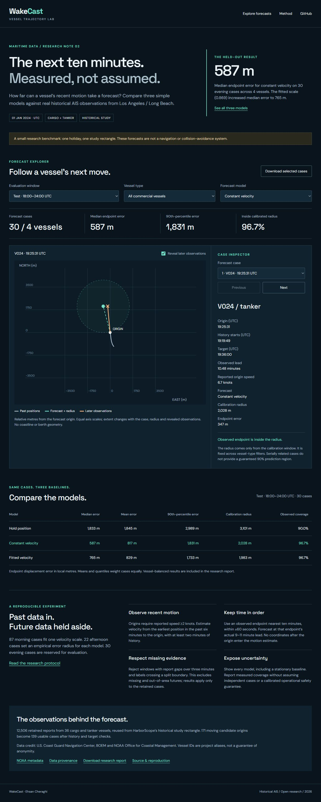

# WakeCast — Vessel Trajectory Lab

A reproducible short-horizon forecasting experiment on historical AIS shipping data, with a browser-based case explorer. Predict vessel displacement using recent positions, compare three transparent baselines, and measure how empirical error radii transfer to a later time window.

[Live demo](https://ehsan-ch.github.io/wakecast-trajectory-lab/) · [Protocol](RESEARCH.md) · [Data provenance](DATA_NOTES.md)



## What the experiment found

On 30 held-out evening cases across four vessels, constant velocity produced a **587 m median endpoint error**, compared with 1,833 m for holding position and 765 m for a training-fitted velocity scale. The fitted model improved the 90th-percentile error but worsened the median and mean. All models are reported; there is no test-driven model selection.

| Model | Test median | Test mean | Test p90 | Calibration radius | Test coverage |
| --- | ---: | ---: | ---: | ---: | ---: |
| Hold position | 1,833 m | 1,845 m | 2,989 m | 3,101 m | 90.0% |
| Constant velocity | 587 m | 817 m | 1,831 m | 2,028 m | 96.7% |
| Fitted velocity | 765 m | 829 m | 1,733 m | 1,983 m | 96.7% |

These are descriptive results for a small, dependent sample, not evidence of operational navigation performance. The nominal 90% radius has no claimed finite-sample guarantee here because serial cases are not exchangeable.

## Explore

- Filter training, calibration or test cases and cargo/tanker vessels.
- Inspect past positions, each forecast, later observations and an empirical error radius.
- Hide the later observations to inspect the available history. Aggregate metrics remain retrospective.
- Export the exact selected cases, timestamps, errors and displacement forecasts as CSV.

The plot uses relative metres with equal axis scales. It is not a nautical chart and has no coastline, berth or collision geometry.

## Reproduce

Python 3.11+ and Node 22; no third-party Python or JavaScript packages are required.

```sh
git clone https://github.com/Ehsan-Ch/wakecast-trajectory-lab.git
cd wakecast-trajectory-lab
python -m unittest discover -s tests -v
python verify.py
npm test
python build.py
npm start
```

Open `http://127.0.0.1:8800/`. `build.py` rebuilds all cases, the fitted coefficient, error radii and metrics from the included CSV. `verify.py` independently reruns that pipeline and reconciles it against the committed report with tight numeric tolerances. It does not redownload the national archive.

`python fetch_data.py` optionally restores the reduced CSV from its pinned upstream commit, verifies its SHA256 before replacing the local copy, and needs internet access. The included CSV is sufficient for all normal checks.

## Research design

The input is HarborScope’s 12,506 retained cargo/tanker reports for 36 vessels on 1 January 2024 UTC in a Los Angeles/Long Beach study rectangle. Of 171 moving candidate origins, 139 have sufficient history and observed targets. Training: 87 cases before noon; calibration: 22 cases from noon to 18:00; test: 30 later cases.

Velocity is the displacement from the earliest position in the last six minutes to the origin, divided by elapsed time. A least-squares scalar is fitted on training cases only (0.869), constrained to [0, 1.5]. Targets are the nearest observed positions to ten minutes, within ±60 seconds; each forecast is evaluated at that target’s actual 9–11 minute lead. No future coordinates enter the velocity features.

Missing futures and long gaps are excluded, which introduces a coverage-selection bias. This one holiday/day, small rectangle and limited vessel sample cannot establish generalization. See the protocol for exact sampling, quantiles, split rules and limitations.

## Files

- `analysis.py`, `config.json`: explicit sampling, models and metrics.
- `data/points.csv`, `data/source_manifest.json`: retained observations and original archive provenance.
- `report.json`: every evaluated case, feature history, predictions, later observations and aggregate results.
- `app.mjs`, `core.mjs`: buildless interactive explorer and export logic.
- `tests/`, `.github/workflows/tests.yml`: synthetic edge cases, temporal checks, export and report reconciliation.

Data credit: U.S. Coast Guard Navigation Center, BOEM, NOAA Office for Coastal Management. Code is MIT; this license does not assert exclusive rights over the provider observations. Historical research only; not for navigation or collision avoidance.
